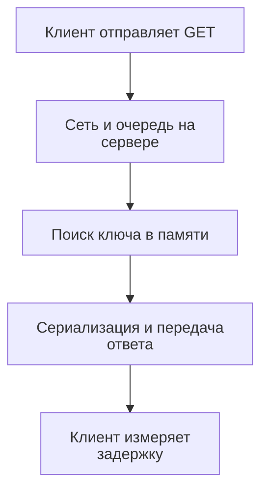
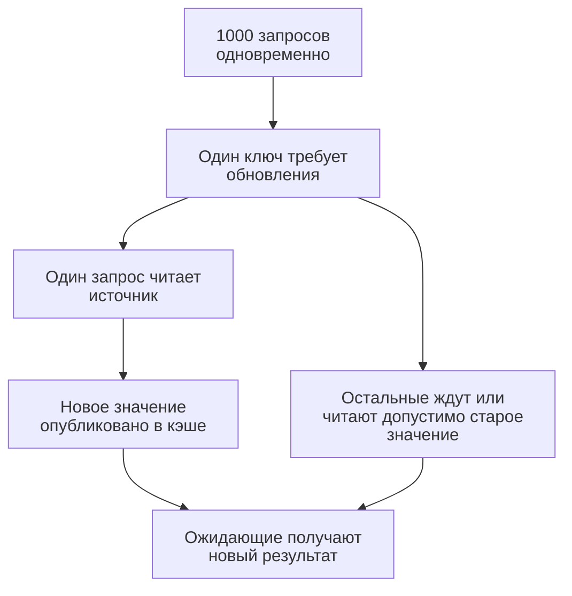
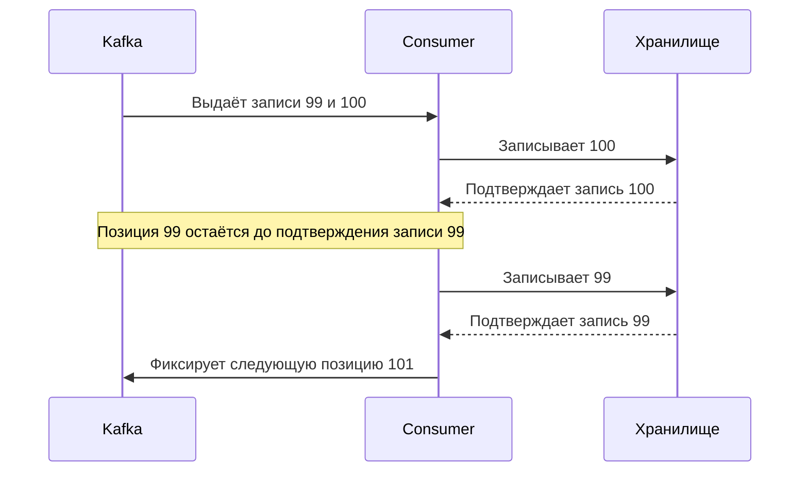
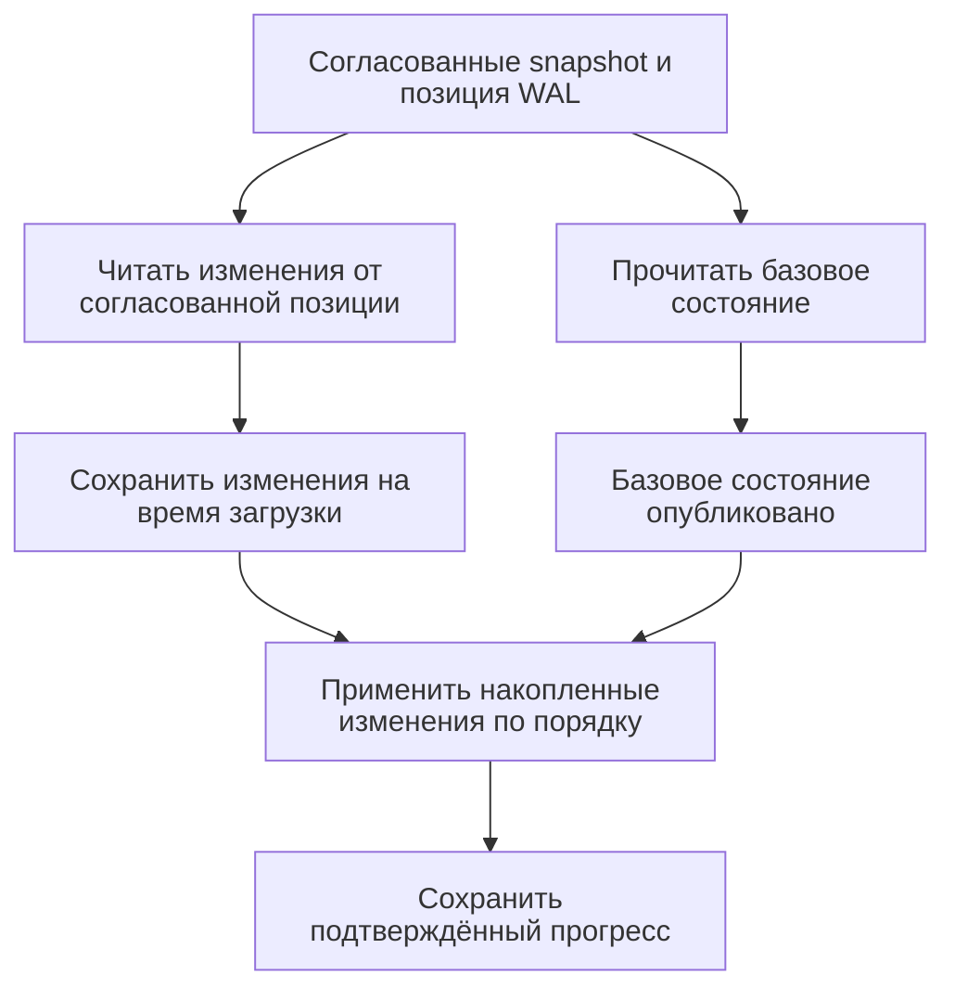
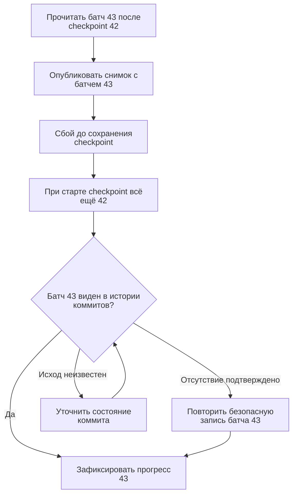
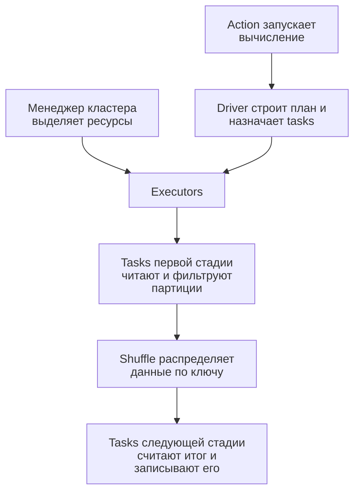
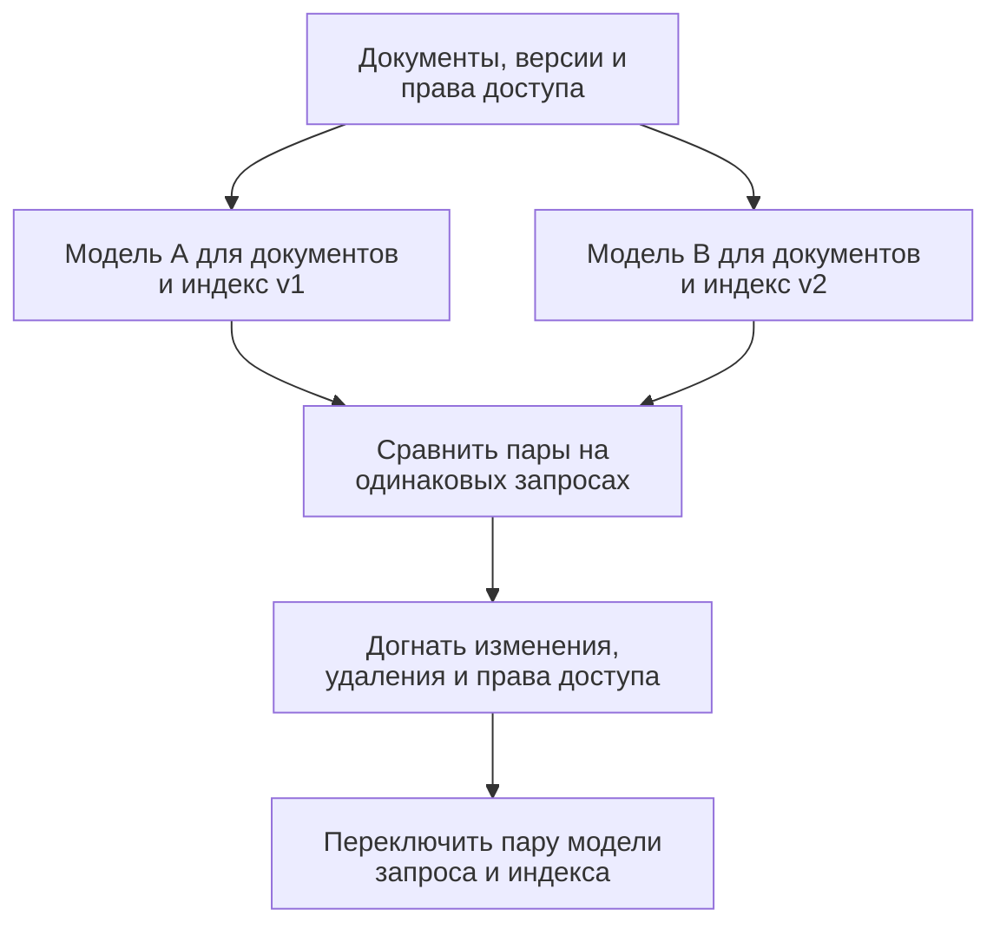
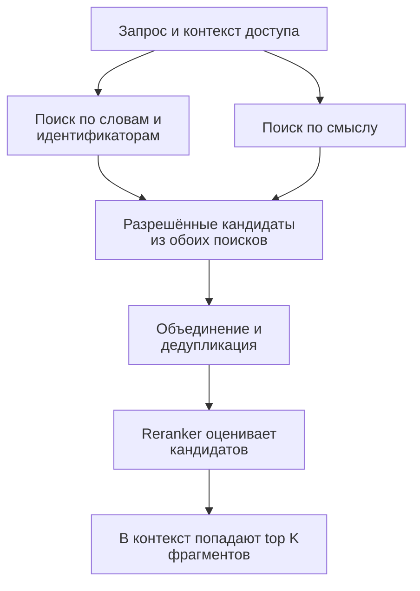
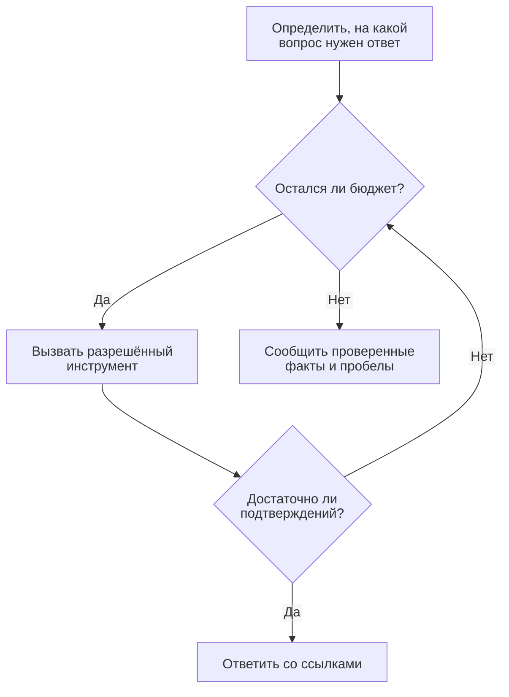

# Вопросы для Data Engineer по сохранённым публикациям LinkedIn

В сохранённом списке на 24 ноября 2026 года было 29 публикаций. Подборка объединяет их темы, связанные с Data Engineering, в задачи для собеседования. У каждого вопроса есть ответ, пример и разбор по шагам или схема. Названия технологий и кейсов взяты из публикаций, а сценарии и числа в примерах условные.

| Раздел | Вопросы | Что потренировать |
|---|---:|---|
| [Linux, Redis и PostgreSQL](#linux-redis-и-postgresql) | 1–9 | Диагностика, кэш, изоляция и масштабирование БД |
| [API, Kafka и CDC](#api-kafka-и-cdc) | 10–17 | Повторы, порядок событий и публикация данных |
| [Spark, dbt и эксплуатация](#spark-dbt-и-эксплуатация) | 18–26 | План выполнения, контракты, тесты и инциденты |
| [Архитектурные компромиссы](#архитектурные-компромиссы) | 27–32 | Задержка, пропускная способность, доступность и цена |
| [Алгоритмы для coding-раунда](#алгоритмы-для-coding-раунда) | 33–38 | Окна, хеширование, top K, интервалы и графы |
| [RAG и управление AI-пайплайнами](#rag-и-управление-ai-пайплайнами) | 39–45 | Индексация, качество поиска, инструментальные вызовы и контроль изменений |

## Linux, Redis и PostgreSQL

### 1. Куда положить настройки, журналы, временные данные и checkpoint Linux-задачи? · Junior

**Ответ.** Системные настройки часто размещают в `/etc`, сервисные логи можно отдавать в журнал системы или собирать из stdout, а временный spill хранить на выделенном локальном диске. Checkpoint требует хранилища, доступного после пересоздания воркера. `/proc` показывает информацию о запущенном процессе и ядре.

**Пример.** Воркер записал прогресс в `/tmp` внутри контейнера. После его пересоздания прогресс потерялся и задача перечитала вход. Сохраните прогресс в долговечном хранилище, а локальный файл используйте для временной сортировки.

**Разбор по шагам.** При запуске воркер читает настройки и сохранённый checkpoint. Во время сортировки он пишет промежуточные данные на локальный диск, а журнал отправляет в сборщик логов. После подтверждения записи результата воркер сохраняет новый checkpoint. При замене контейнера следующий воркер продолжает с этой позиции.

### 2. Почему простой GET в Redis быстрый и откуда берётся высокий p99? · Middle

**Ответ.** Redis принимает команду по протоколу RESP, находит ключ в структуре данных в памяти и возвращает результат. Во многих конфигурациях основной поток выполняет команды последовательно. Сеть, крупный payload, долгие команды, очереди и фоновые операции способны увеличить хвост задержки.

**Пример.** Одиночный GET занимает доли миллисекунды на сервере, но клиент делает 100 запросов подряд через сеть. Сравните p99 и объём ответов при последовательных запросах и при ограниченном pipelining. Pipelining уменьшает число ожиданий сети и не даёт атомарности. [Redis RESP](https://redis.io/docs/latest/develop/reference/protocol-spec/).

**Схема задержки.** Время команды на сервере составляет только часть времени, которое видит клиент.



1. Измерьте p99 на клиенте и проверьте серверные задержки за тот же период. Redis SLOWLOG показывает время выполнения команды и исключает время клиентского I/O.
2. Сравните одиночные запросы и небольшой pipeline при одинаковой нагрузке и размере ответов. Если меняется только клиентская задержка, проверьте сетевые ожидания и очередь. Если растёт и время отдельных команд, разберите команды и объём данных. [Redis latency diagnosis](https://redis.io/docs/latest/operate/oss_and_stack/management/optimization/latency/).

### 3. Чем отличаются TTL, eviction, RDB и AOF? · Middle

**Ответ.** TTL задаёт срок жизни отдельного ключа. Политика eviction определяет, что происходит при заполнении памяти. RDB сохраняет снимок данных, AOF записывает операции для восстановления состояния. При выборе режима учитывают допустимую потерю данных, время восстановления и частоту синхронизации с диском.

**Пример.** Ключ с TTL 60 секунд может исчезнуть через 10 секунд при нехватке памяти. Для кэша это обычно допустимо, если значение восстанавливается из источника. Для реестра обработанных платежей такое исчезновение открывает окно повторной обработки. [Redis eviction](https://redis.io/docs/latest/reference/eviction/), [Redis persistence](https://redis.io/docs/latest/management/persistence/).

**Разбор срока жизни и восстановления ключа.**

| Событие | Что решает исход |
|---|---|
| TTL ключа истёк | Ключ считается просроченным при обращении. Физически Redis удаляет такие ключи при обращении и фоновой проверке. |
| Память заполнена до истечения TTL | Применяется eviction policy. Например, при allkeys-lru ключ может быть вытеснен раньше своего TTL. |
| Процесс перезапустился | RDB восстанавливает состояние снимка. Настроенный AOF позволяет восстановить операции в пределах сохранённого журнала. Допустимое окно потерь зависит от конфигурации. |

### 4. Как предотвратить cache stampede при обновлении витрины? · Middle

**Ответ.** Объединяйте одновременные запросы за одним ключом, распределяйте сроки истечения TTL со случайным разбросом и ограничивайте параллельное обращение к источнику. Если договор свежести позволяет, отдавайте старое значение во время фонового обновления.

**Пример.** Тысяча запросов пришла в момент истечения ключа с курсом валют. Один запрос обновляет кэш, остальные ждут ограниченное время или получают последний опубликованный курс. Отдельно измерьте возраст данных и нагрузку на источник.

**Схема одновременного промаха по одному ключу.**



Если обновление завершилось ошибкой, ограничьте ожидание и выберите реакцию по договору свежести. Случайный разброс TTL помогает разнести истечение разных ключей. Для одновременных запросов к одному ключу нужна координация обновления.

### 5. Что такое схема PostgreSQL и почему `search_path` важен для ETL? · Junior

**Ответ.** Схема организует объекты внутри базы и позволяет существовать одноимённым таблицам. PostgreSQL разрешает неквалифицированное имя по порядку поиска. Доступ к схеме и права на отдельные объекты проверяются отдельно. Для важных зависимостей полезны явные имена и контролируемые права.

**Пример.** `sales.orders` содержит первичные заказы, `analytics.orders` содержит очищенную витрину. После смены роли запрос с одним `orders` может прочитать другую таблицу. Укажите схему и проверьте, какие права получит роль загрузчика. [PostgreSQL Schemas](https://www.postgresql.org/docs/current/ddl-schemas.html).

**Разбор разрешения имени.** При порядке поиска analytics → sales ссылка orders разрешится в analytics.orders, если схема доступна и такой объект в ней есть. При порядке sales → analytics выберется sales.orders. Явное имя analytics.orders фиксирует объект. Затем PostgreSQL отдельно проверяет права роли на схему и таблицу.

### 6. Когда выбрать schema-per-tenant, общую таблицу с RLS или отдельные базы? · Senior

**Ответ.** Общие таблицы упрощают миграции и аналитику. Политики RLS требуют проверки для каждой выполняющей запрос роли. Отдельные схемы облегчают разграничение объектов, но увеличивают число миграций. Отдельные базы упрощают раздельное восстановление и изоляцию ценой более сложной эксплуатации. Отдельный workload может требовать отдельного инстанса.

**Пример.** Для 500 небольших клиентов общая схема может быть удобнее при проверенной изоляции строк. Крупному клиенту с независимым графиком восстановления можно выделить отдельную базу. Проверьте права сервисных ролей, бэкапы и восстановление на копии. [PostgreSQL Row Security](https://www.postgresql.org/docs/current/ddl-rowsecurity.html).

**Разбор решения.**

1. Определите требования к восстановлению, изоляции и общей аналитике.
2. Для общей таблицы проверьте политику RLS на реальной роли приложения с двумя условными арендаторами. Для раздельных схем проверьте права и раскатку одной миграции на все схемы.
3. Если восстановление отдельного клиента критично, проверьте восстановление из копии и сравните трудозатраты для выбранной схемы или выделенной базы.

### 7. Как выбрать между управляемыми PostgreSQL-сервисами вроде Neon и Supabase? · Middle

**Ответ.** Сравните требования к расширениям, длительным соединениям, логической репликации, резервным копиям и регионам. Затем проверьте ограничения тарифа, поведение пула и холодного старта на своём workload. Разделение compute и storage с ветвлением полезно для тестовых окружений. Интегрированные сервисы приложения важны, если команда собирается ими пользоваться.

**Пример.** Коннектору CDC нужен слот репликации, а ETL через пул использует состояние сессии. Проверьте оба сценария на конкретном тарифе перед выбором провайдера. [Neon architecture](https://neon.com/docs/introduction/architecture-overview), [Supabase Database](https://supabase.com/docs/guides/database/overview).

**Разбор сравнения.**

1. Выпишите обязательные свойства: логическая репликация, расширения и требуемый режим пула.
2. На тестовой базе проверьте восстановление коннектора после разрыва и поведение запросов, которым нужно состояние сессии.
3. Для прошедших вариантов сравните время первого запроса, задержку под нагрузкой и стоимость типового месяца.

### 8. Когда помогут пул соединений, реплики, индексы и шардинг? · Senior

**Ответ.** Пул ограничивает число подключений к БД. Реплики могут перенести часть нагрузки чтения с primary и добавляют вопрос отставания. Индекс сокращает стоимость подходящих запросов и увеличивает работу при записи. Шардинг распределяет данные, добавляя маршрутизацию, ребалансировку и стоимость запросов между шардами.

**Пример.** Если медленная витрина запускает один и тот же тяжёлый запрос тысячу раз, сравните его план и стоимость кэширования до масштабирования. Если запись достигла предела primary и нагрузку можно разделить по клиентам, оцените шардирование и отдельно разберите крупных клиентов.

**Разбор от метрики к действию.**

| Что наблюдаем | Первый шаг проверки |
|---|---|
| Много подключений, часть простаивает | Измерить активные сессии и проверить эффект ограниченного пула. |
| Дорогой запрос читает много лишних страниц | Сравнить фактический план до и после изменения запроса или индекса. |
| Primary перегружен чтением | Оценить допустимое отставание данных и перенести подходящие чтения на реплику. |
| Запись упирается в один сервер | Сравнить предел вертикального масштабирования с разбросом нагрузки по ключам шардирования. |

### 9. Почему чтение сразу после записи может вернуть старое значение? · Middle

**Ответ.** При асинхронной репликации подтверждение записи на primary может опередить её применение на реплике. Для read-your-writes читайте с primary в нужной области либо ждите, пока реплика достигнет известной позиции записи, если инфраструктура это поддерживает.

**Пример.** ETL записал новые данные, а проверка на отстающей read replica видит вчерашний результат. Для контроля публикации используйте согласованный снимок primary или проверяйте позицию применения изменений.

**Разбор во времени.** Primary подтвердил запись на позиции LSN 500. Реплика применила журнал только до LSN 470 и возвращает старое значение. Проверка на primary видит подтверждённую запись. Проверка на реплике с требованием read-your-writes ждёт подтверждения, что она применила журнал до нужной позиции, и обрабатывает таймаут.

Публикации для повторения. [Устройство Redis](https://www.linkedin.com/feed/update/urn:li:activity:7528150168873893888), [Linux](https://www.linkedin.com/feed/update/urn:li:activity:7521559831816880129), [масштабирование БД](https://www.linkedin.com/feed/update/urn:li:activity:7523727019814047745), [сравнение Postgres-провайдеров](https://www.linkedin.com/feed/update/urn:li:activity:7221499304752922624). Карточка «Что такое схема в бд?» доступна в [сохранённом списке](https://www.linkedin.com/my-items/saved-posts/).

## API, Kafka и CDC

### 10. Клиент отправил POST и получил таймаут. Как повторить запрос без двойной операции? · Middle

**Ответ.** Клиент создаёт ключ для одной логической операции и использует его при повторах. На стороне API уникальное ограничение и согласованный переход состояния защищают от параллельных повторов. Проверяйте соответствие параметров и поддерживайте срок хранения ключа, достаточный для возможных повторов. Внешний побочный эффект требует отдельной гарантии.

**Пример.** Первая попытка `payment-42` завершилась записью, но клиент потерял HTTP-ответ. Повтор с тем же ключом возвращает сохранённый исход. Новый заказ получает новый ключ. Stripe, например, сверяет параметры запроса и может удалить ключи после того, как им исполнится не менее 24 часов. [Stripe Idempotent requests](https://docs.stripe.com/api/idempotent_requests).

**Разбор повтора.**

1. Клиент посылает запрос с ключом payment-42. Сервис связывает ключ с параметрами и результатом операции.
2. Сервис записал результат, но ответ потерялся. Клиент отправляет те же параметры и тот же ключ. Сервис возвращает зафиксированный результат.
3. При параллельном запросе с тем же ключом атомарная регистрация определяет одного исполнителя. Повтор с другими параметрами вызывает конфликт по договору API.

### 11. Что происходит между записью в sink и commit offset в Kafka? · Middle

**Ответ.** Подтверждение offset до durable-записи создаёт окно потери. При записи до подтверждения сбой может вызвать повтор. Повторный эффект предотвращают атомарным учётом обработанной позиции в sink или стабильным ключом с идемпотентной записью. Commit должен отражать непрерывный обработанный префикс каждой партиции.

**Пример.** В двух потоках offset 99 ещё обрабатывается, а 100 уже записан. Подтвердив позицию 101, consumer после сбоя пропустит 99. Храните непрерывную границу и дождитесь завершения отставшей записи. [Kafka Design](https://kafka.apache.org/41/design/design/).

**Схема безопасной границы.** В этой партиции позиция commit означает следующий offset для чтения после восстановления.



При сбое после записи 100 Kafka выдаст 99 и 100 снова. Идемпотентная запись сохранит один эффект от 100. Преждевременный commit 101 пропустил бы 99 при восстановлении.

### 12. Как выбрать ключ партиции Kafka, если важен порядок обновлений? · Middle

**Ответ.** Выбирайте ключ, соответствующий бизнес-сущности, чей порядок нужно сохранять. Kafka упорядочивает записи внутри партиции. Параллельная обработка может изменить порядок применения, поэтому sink проверяет версию или последовательность, если требуется. Горячие ключи ограничивают параллелизм.

**Пример.** События заказа 42 попадают в одну партицию. При смене количества партиций протестируйте распределение и порядок во время перехода. Для одного слишком активного клиента учитывайте, какие его события действительно требуют общего порядка. [Kafka Design](https://kafka.apache.org/41/design/design/).

**Разбор порядка.**

```text
Ключ order-42 → партиция P0 → CREATED v1 → PAID v2
Ключ order-81 → партиция P1 → CREATED v1 → CANCELLED v2
```

Если параллельный обработчик применил PAID v2 раньше CREATED v1, обновление по версии должно сохранить v2. Этот приём подходит для записи актуального состояния. Когда каждый переход сам имеет бизнес-эффект, обрабатывайте переходы по порядку внутри ключа.

### 13. Как совместить initial snapshot и непрерывный CDC из PostgreSQL? · Senior

**Ответ.** Свяжите исходный снимок с позицией журнала WAL. Первичное чтение обеспечивает базовое состояние, а logical decoding передаёт изменения после согласованной границы. Документируйте порядок применения транзакций, retry, обработку DELETE и проверку поддержки схемы. Контролируйте retention WAL и прогресс слота.

**Пример.** Строка 42 обновилась во время копирования 2 ТБ. Снимок содержит старое значение, а поток изменений приносит новое. Применение снимка и CDC через управляемую границу воспроизводит новое состояние без пропуска обновления.

**Схема первичной загрузки.** Снимок и старт потока согласуются через одну границу чтения PostgreSQL.



1. В снимке строка 42 имеет состояние NEW. Во время копирования PostgreSQL подтверждает UPDATE до PAID. Изменение попадает в поток WAL.
2. Загрузите NEW из снимка и затем примените PAID из потока. Обработайте UPDATE и DELETE по ключу и порядку источника.
3. Подтвердите прогресс после надёжного применения данных или после передачи их в долговечный буфер с собственным восстановлением. Отслеживайте отставание слота и объём удерживаемого WAL.


[PostgreSQL Logical Decoding](https://www.postgresql.org/docs/current/logicaldecoding-explanation.html).

### 14. CDC напрямую пишет в Iceberg. Как восстановиться после сбоя между commit таблицы и сохранением позиции? · Senior

**Ответ.** Сохраняйте позицию чтения только после подтверждённого коммита. Если последовательность коммитов уже включает отправленный батч, повтор должен распознать его либо применить изменения без регрессии версий. Выбор механизма зависит от writer и каталога. Зафиксируйте обработку DELETE и последовательность для нескольких изменений одной строки в транзакции.

**Пример.** Снимок таблицы уже включает условный батч 43, а checkpoint остался на 42. Повторное чтение батча 43 должно восстановить прогресс, сохранив одну версию каждой строки. Тестируйте этот сбой отдельно от сбоя до публикации. [PostgreSQL Logical Decoding](https://www.postgresql.org/docs/current/logicaldecoding-explanation.html), [Iceberg Spec](https://iceberg.apache.org/spec/).

**Схема восстановления.** Пример предполагает, что writer записывает идентификатор диапазона источника в том же коммите, который публикует изменения таблицы.



Привяжите идентификатор к диапазону и источнику, чтобы он переживал повтор процесса. Храните доказательство применения достаточно долго для восстановления. Если состояние коммита пока неизвестно, сначала выясните исход. При повторе через upsert проверяйте порядок по ключу и сохраняйте обработку DELETE.

### 15. Как обеспечить малую задержку CDC без бесконечного роста мелких файлов? · Senior

**Ответ.** Отделите частоту публикации изменений от фонового объединения файлов. Частые небольшие коммиты дают быстрый доступ к новым данным и увеличивают расходы на метаданные и чтение. Измеряйте задержку от commit источника до видимости в запросе, p95, размер файлов, стоимость compaction, задержку чтения и режим backfill.

**Пример.** Частые записи дают свежесть порядка секунд, а растущее число файлов ухудшает p95 отчёта. Проверьте, насколько укрупнение затронутых диапазонов помогает чтению при том же потоке изменений и частоте коммитов. [Iceberg Spec](https://iceberg.apache.org/spec/).

**Разбор двух циклов.**

```text
Быстрый цикл     батчи CDC → небольшие файлы → новый снимок → свежие данные
Фоновый цикл     выбор области → слияние мелких файлов → новый снимок
```

Сравните два режима при одной и той же входной нагрузке. Для CDC измерьте p95 от коммита PostgreSQL до видимости обновления в Iceberg. Для compaction измерьте количество файлов, объём перезаписи и p95 типового запроса. При конфликте с живой записью перепланируйте compaction на актуальном снимке по правилам writer.

### 16. Почему строгой согласованности S3 недостаточно для атомарной публикации таблицы? · Middle

**Ответ.** Согласованность отдельного объекта и протокол коммита набора файлов описывают разные уровни. Табличный формат связывает файлы с опубликованной версией данных через метаданные и коммит каталога. Читатель выбирает опубликованный снимок, а параллельные writers разрешают конфликт по правилам формата.

**Пример.** Загрузка записала три объекта из пяти и упала. Эти три могут быть видимы в S3, но читатель Iceberg остаётся на предыдущем снимке, если новый снимок не опубликован. [Amazon S3 consistency](https://docs.aws.amazon.com/AmazonS3/latest/userguide/Welcome.html#ConsistencyModel), [Iceberg Spec](https://iceberg.apache.org/spec/).

**Разбор видимости данных.**

1. Читатель открывает опубликованный снимок S0 через каталог. Писатель загружает новые объекты, часть которых уже доступна через S3.
2. Писатель падает до смены указателя каталога. Новый читатель по-прежнему открывает S0, а неподключённые объекты остаются вне этого снимка.
3. При успешном повторе писатель публикует S1. Новые чтения могут открыть S1, а запрос, начатый со снимком S0, продолжает читать его до завершения.

### 17. Как спроектировать пагинацию, backpressure и обработку некорректных записей? · Middle

**Ответ.** Используйте стабильный курсор и сохраняйте его после надёжной записи. Ограничьте число запросов и размер очереди, для временных ошибок применяйте backoff с jitter. Ошибки данных сохраняйте в карантин с причиной, идентификатором и процедурой replay. Проверяйте контракт на изменение данных между страницами.

**Пример.** API отвечает 429, а хранилище замедлилось. Замедлите чтение и оцените отставание. Страница с повреждённой суммой требует отдельной проверки данных. Сохраните ошибочную запись для исправления и восстановления при контролируемом повторе.

**Разбор одной страницы.** Воркер загружает страницу по сохранённому курсору и делит строки на валидные и отклонённые. Сначала он надёжно сохраняет оба результата, затем продвигает курсор. При 429 сохраняет текущую позицию и ждёт с учётом Retry-After, если он есть. Если хранилище отстаёт, ограниченная очередь заставляет чтение ждать.

Публикации для повторения. [Идемпотентность платежей](https://www.linkedin.com/feed/update/urn:li:activity:7525187539532427264), [Postgres → Iceberg](https://www.linkedin.com/feed/update/urn:li:activity:7503867634858250240), [сценарии Kafka и S3](https://www.linkedin.com/feed/update/urn:li:activity:7524811121740939264).

## Spark, dbt и эксплуатация

### 18. Что делают driver, cluster manager и executors, когда запускается Spark job? · Junior

**Ответ.** Driver координирует приложение и планирует работу. Менеджер кластера предоставляет ресурсы. Executors выполняют задачи над партициями. Для типичного вычисления action запускает job, который разбивается на stages и tasks. Один action может породить несколько jobs.

**Пример.** `filter → groupBy → sum → write` обычно читает и фильтрует часть данных в первой стадии, затем передаёт данные через shuffle для агрегации по ключу. План и Spark UI показывают фактические границы стадий. [Spark Cluster Mode Overview](https://spark.apache.org/docs/latest/cluster-overview.html).

**Схема Spark job.** Пример показывает штатное вычисление агрегата по ключу с обменом данными между партициями.



В Spark UI откройте SQL-план и стадии задания. Оператор Exchange показывает перераспределение, а метрики задач помогают увидеть, какие партиции стали узким местом. Фактический план зависит от источника, настроек и оптимизатора.

### 19. Почему Spark может выиграть у MapReduce и всё равно писать промежуточные данные на диск? · Middle

**Ответ.** Spark соединяет совместимые операции в DAG, передаёт результаты между этапами и позволяет повторно использовать материализованные наборы. Shuffle, spill, checkpoint и недостающая память могут создавать запись на диск. Преимущество зависит от плана, объёма данных и профиля нагрузки.

**Пример.** Модель обучения десять раз читает один набор признаков. Переиспользование рассчитанного набора может помочь. У крупного join с перекосом и нехваткой памяти сначала ищите shuffle и spill, а затем проверяйте пользу кэша. [Spark RDD Programming Guide](https://spark.apache.org/docs/latest/rdd-programming-guide.html).

**Разбор, когда появляется I/O.**
1. Фильтр и проекция могут пройти в одной стадии по входной партиции. Если несколько вычислений используют один дорогой промежуточный результат, измерьте эффект его кэширования.
2. Группировка по ключу может вызвать shuffle. Проверьте обмен между задачами и объём shuffle read и write. Если оператору не хватает рабочей памяти, проверьте метрики spill.
3. Сравните время всего расчёта с кэшем и без него. Учитывайте стоимость первого вычисления и ресурсы для хранения кэша.

### 20. В Spark 199 tasks завершились быстро, а одна зависла. Что проверите? · Middle

**Ответ.** Сопоставьте длительность с объёмом входа, shuffle read, spill, временем GC и состоянием executor. Перекос данных вероятен, если медленная задача получила намного больше записей. При подтверждённом skew протестируйте частичную агрегацию, подходящую стратегию join, AQE или salting с проверкой результата.

**Пример.** Один клиент даёт 80% строк. Добавление партиций сохраняет этот ключ в одном месте при том же разбиении. Агрегация сначала по паре `(customer_id, salt)`, затем по `customer_id` распределяет вычисление суммы. [Spark SQL Performance Tuning](https://spark.apache.org/docs/latest/sql-performance-tuning.html).

**Разбор по метрикам Spark UI.**

| У медленной задачи | Следующая проверка |
|---|---|
| Shuffle read и число строк сильно выше медианы | Проверить распределение ключей и размер партиции. |
| Размер входа сопоставим с остальными, GC или spill сильно выше | Сравнить память, соседние задачи и нагрузку executor. |
| Время ожидания чтения выше при сопоставимом объёме | Сравнить состояние executor, сети и источника. |

Для суммы по горячему ключу разложите строки по нескольким salt, посчитайте частичные суммы, затем сложите их по исходному ключу. Проверьте равенство итогов и изменение длительности самой медленной задачи. Для среднего объединяйте частичные суммы и количества ненулевых значений, если исходная функция AVG пропускает NULL.

### 21. Когда разбивать большой dbt-проект на домены? · Senior

**Ответ.** Начните с измеримого узкого места. В одном проекте можно выделить группы и владельцев, сузить CI и стабилизировать интерфейсы. Разделение проектов оправдано, когда команды реально выпускают изменения независимо и способны поддерживать публичные зависимости, порядок выкладок и взаимодействие при сбоях.

**Пример.** Finance использует только стабильную витрину Orders, а Sales меняет внутренние промежуточные модели ежедневно. Опубликуйте узкий интерфейс Orders, назначьте владельца и договор свежести. Возможность cross-project references проверьте для версии и окружения. [dbt Mesh](https://docs.getdbt.com/docs/mesh/about-mesh), [Project dependencies](https://docs.getdbt.com/docs/mesh/govern/project-dependencies).

**Разбор границы между доменами.** Снимите исходные показатели CI и число изменений, затрагивающих другие команды. Выделите стабильную витрину Sales Orders для Finance и проверьте, может ли Sales обновлять внутренние модели без выкладки Finance. Если зависимость от общего выпуска сохраняется, сначала упростите договор между командами.

### 22. Как безопасно изменить публичную модель, если тип колонки остаётся тем же? · Middle

**Ответ.** Согласуйте форму результата, зерно, валюту, временную зону и смысл показателей. Контракт схемы защищает форму, а семантику проверяют тесты и владельцы. При несовместимом изменении можно поддержать две версии, перевести потребителей и убрать старую по согласованному сроку.

**Пример.** Поле `revenue` по-прежнему DECIMAL, но теперь выражено в центах. Старый отчёт покажет выручку в 100 раз больше, даже если контракт типов пройдёт. Новое имя или версия и тест на контрольном заказе обнаружат смену единиц. [dbt Model contracts](https://docs.getdbt.com/docs/mesh/govern/model-contracts), [Model versions](https://docs.getdbt.com/docs/mesh/govern/model-versions).

**Разбор выпуска.**

1. Зафиксируйте контрольный заказ на 12,34 в исходных денежных единицах. Старая версия отдаёт 12,34, новая может отдавать 1234 в поле с явной единицей.
2. Опубликуйте обе версии и проверьте одинаковый денежный итог после перевода единиц. Переведите отчёты и проверьте список оставшихся потребителей.
3. Снимите старый интерфейс после согласованной даты и проверки зависимостей.

### 23. Чем отличаются unit test, data test, freshness и проверка затронутых моделей в CI? · Middle

**Ответ.** Unit test выполняет правило на фиксированных входах. Data test проверяет свойства строк в построенной модели. Freshness измеряет соблюдение допустимого отставания источника. Сравнение с сохранённым manifest помогает выбрать изменившиеся модели, а deferral может разрешить ссылки на неизменённые отношения в другом окружении.

**Пример.** В PR изменили классификацию возвратов. Unit test проверяет пограничный случай, data test ловит дубль ключа, freshness сигнализирует об опоздавшей загрузке. В CI проверьте также влияние на зависимые показатели. [dbt Unit tests](https://docs.getdbt.com/docs/build/unit-tests), [dbt Defer](https://docs.getdbt.com/reference/node-selection/defer).

**Разбор одной правки в CI.**

| Проверка | Что обнаружит в кейсе с возвратами |
|---|---|
| Unit test | Фиксированный возврат классифицирован как покупка. |
| Data test | После сборки один ключ операции появился дважды. |
| Source freshness | Источник загрузил последний батч позже допустимого порога. |
| Выбор по state | Изменённая модель и выбранные потомки попадают в сборку по сравнению с сохранённым manifest. |

Проверьте, на какое окружение указывают ссылки при deferral, особенно если тест сравнивает несколько отношений.

### 24. Оркестратор сообщает success, но выручка упала на 40%. Что делать? · Middle

**Ответ.** Зафиксируйте затронутый интервал и витрины. Сопоставьте свежесть, число ключей и суммы по каждому слою. Посмотрите изменения поставки данных, схемы, фильтров и соединений. Проверьте бизнес-объяснение и границы инцидента, затем исправьте причину и повторно опубликуйте результат с проверкой.

**Пример.** Сумма верна в raw, а в mart пропала половина записей одного источника. Найдите ключи, исчезнувшие после join, и проверьте версию справочника. Успешный пересчёт подтвердите по обоим источникам и ключам, а также проверкой итоговой метрики.

**Разбор локализации.**

```text
raw: 1000 заказов   →   clean: 1000 заказов   →   mart: 600 заказов
                            левая сторона join         400 ключей пропали
```

Сравните ключи на первом слое с расхождением. Проверьте отсутствующие соответствия в справочнике и кратность join на сохранившихся ключах. После исправления пересчитайте затронутый интервал и сравните число заказов и выручку с источником на согласованном зерне.

### 25. Как применить separation of concerns и DRY к ETL без общей абстракции на все случаи? · Middle

**Ответ.** Разделите вход и выход, вычисление и оркестрацию. Общая функция подходит, когда несколько вызовов используют один и тот же договор и меняются вместе. Разным бизнес-правилам дайте явные функции. Документируйте причины странных исключений и проверяйте поведение небольшими тестами.

**Пример.** Два источника используют одинаковый формат дат. Один считает пропуск ошибкой, второй подставляет местную дату расчёта. Можно переиспользовать низкоуровневый парсер и оставить две явные политики обработки пропуска.

**Разбор ответственности.** Общий парсер превращает строку в дату или диагностируемую ошибку. Слой правил первого источника отправляет пустую дату в карантин. Правило второго источника принимает дату расчёта как явный параметр. Проверьте один и тот же пустой вход в обоих сценариях и зафиксируйте два ожидаемых исхода.

### 26. Как проверять изменения, предложенные ассистентом для dbt-репозитория? · Middle

**Ответ.** Ограничьте доступ ассистента нужными исходниками и метаданными. Проверьте diff, зерно, ключ, источники, макросы и затронутых потребителей. Выполните проверку компиляции и тесты на изолированных данных. Выпуск и доступы регулируются обычным процессом команды.

**Пример.** После добавления join модель компилируется, но дублирует строки платежей. Fixture с двумя платежами на один заказ покажет увеличение суммы. Добавьте data test на уникальность заявленного ключа и сравните контрольный итог.

**Разбор проверки diff.** Для одной строки заказа с двумя платежами сначала запишите ожидаемое зерно и сумму. Запустите проверку компиляции и тест на изолированном наборе. Затем сравните количество строк и сумму до и после правки на заказах с одним и несколькими платежами. Для витрины с одной строкой на заказ отдельно проверьте уникальность ключа заказа.

Публикации для повторения. [Spark Architecture](https://www.linkedin.com/feed/update/urn:li:activity:7471209212262445056), [Spark и MapReduce](https://www.linkedin.com/feed/update/urn:li:activity:7461089961744977921), [dbt Mesh](https://www.linkedin.com/feed/update/urn:li:activity:7512484648585748481), [версионирование и тесты dbt](https://www.linkedin.com/feed/update/urn:li:activity:7455849585458999296), [практика Data Engineer](https://www.linkedin.com/feed/update/urn:li:activity:7512338207355637760), [принципы разработки](https://www.linkedin.com/feed/update/urn:li:activity:7497994071278350336), [ассистенты для dbt](https://www.linkedin.com/feed/update/urn:li:activity:7470916330905415680).

## Архитектурные компромиссы

### 27. Как выбирать между batch, micro-batch и обработкой каждого события? · Middle

**Ответ.** Определите допустимый возраст данных, целевой p95 и стоимость операции. Размер батча влияет на ожидание, стоимость записи и частоту публикаций. Добавьте резерв на пики, повторы и восстановление отставания.

**Пример.** При 10 000 строк/с за 5 секунд накопится примерно 50 000 строк. Порог в 5 секунд сам по себе потребляет до 5 секунд бюджета задержки, ещё до обработки и публикации. Для отчёта с минутным SLO это может подойти. Для алерта с SLO 2 секунды нужен другой размер батча или отдельный быстрый путь.

**Разбор бюджета задержки.**

```text
Входное событие → ожидание группы → обработка → публикация
Условный предел ожидания 5 с + обработка 1 с + публикация 0,5 с
Событие в начале группы может стать видно примерно через 6,5 с
```

Проверьте фактическое распределение от времени события до публикации при обычной нагрузке и на пике. Если цель 2 секунды, уменьшите интервал и повторно измерьте задержку, пропускную способность и стоимость записи.

### 28. Когда использовать очередь задач, а когда журнал событий? · Middle

**Ответ.** Для выполнения задания понадобится распределение работы и подтверждение результата. Для истории событий понадобятся независимые позиции чтения и replay. Многие системы совмещают эти свойства, поэтому сравнивайте retention, порядок, модель подтверждения и возможности идентификации сообщений.

**Пример.** Очередь распределяет отправку отчёта между воркерами. Журнал заказов позволяет витрине финансов и сервису расчёта запасов читать данные независимо. При изменении правил витрина может восстановиться из доступной истории. [Kafka Design](https://kafka.apache.org/41/design/design/).

**Разбор получения и повтора.** Для очереди воркер A получает задание, выполняет его и подтверждает. При таймауте доставки воркер B может получить то же задание, поэтому обработчик учитывает повтор. Для журнала группа финансов читает позицию 120, а группа запасов — 105. Каждая продвигает свою позицию независимо и может повторить доступную историю.

### 29. Что выбрать для ingestion-сервиса — модульный монолит, микросервисы или serverless? · Senior

**Ответ.** Модульный монолит упрощает согласованность и выпуск небольшой командой. Независимые сервисы дают разные циклы выпуска, масштабирование и границы сбоев, добавляя сетевые зависимости. Serverless подходит для событийной нагрузки с подходящими лимитами выполнения и конкуренции. Serverless описывает модель исполнения и может использоваться внутри разных архитектур.

**Пример.** Три небольших API-выгрузки с общим графиком можно вести одним сервисом с отдельными адаптерами. Частые webhook-события с коротким временем обработки можно вынести в функцию. При этом тяжёлый backfill требует собственного бюджета ресурсов и защиты от одновременной публикации результата.

**Разбор роста нагрузки.**

1. Для трёх выгрузок со схожим расписанием начните с одного модуля оркестрации и отдельных адаптеров.
2. Если webhook требует своего бюджета задержки и масштаба, сравните отдельный сервис и функцию. Проверьте лимиты конкуренции, время выполнения и повтор доставки.
3. При совпадении live-загрузки и backfill согласуйте владение интервалами или публикацию версий данных и проверьте сбой одного пути во время работы другого.

### 30. Как спроектировать события сделки для аналитики биржи или заказов? · Senior

**Ответ.** Выберите ключ потока и стабильную позицию источника. Разделите время события и время применения. Храните сырые события для аудита и восстановления, а снимки состояния стройте по известным границам. При разрыве последовательности определите, как запросить пропущенный диапазон или восстановиться из снимка.

**Пример.** Позиция 100 обработана, 102 получена, а 101 ещё отсутствует. Snapshot с позицией 100 и последующие записи 101–102 позволяют восстановить состояние в правильном порядке. Инвариант для интервью — сколько раз учитывается каждая сделка после replay.

**Разбор восстановления последовательности.**

```text
Состояние подтверждено до позиции 100 включительно.
Получили 102, обнаружили пропуск и временно отложили эту запись.
Повторно прочитали 101, применили 101 → 102, сохранили позицию 102.
Повтор с позиции 100 использует стабильные идентификаторы событий.
```

Проверка сценария подтверждает согласованный порядок и однократный эффект событий после повторной доставки.

### 31. Как спроектировать поиск ближайших водителей по потоку координат? · Senior

**Ответ.** Публикуйте последнее состояние по идентификатору водителя, проверяйте время и версию. Пространственный индекс сокращает набор кандидатов, после чего точный расчёт расстояния и условия пригодности отбирают результат. Для граничных случаев проверяйте соседние ячейки и срок годности координат.

**Пример.** Клиент рядом с границей ячейки A, а ближайший водитель в ячейке B. Поиск по A и соседям вернёт обоих кандидатов. Координаты старше условных 30 секунд исключаются по договору, даже если водитель ранее был ближе всех.

**Разбор поиска у границы ячейки.**

1. Поиск по ячейке A и её соседям находит водителей из A и B.
2. Отбрасываем занятых водителей и координаты старше 30 секунд.
3. Считаем расстояния для оставшихся кандидатов и упорядочиваем их. Если нужен радиус, подберите набор ячеек, полностью покрывающий область поиска.

### 32. Как изменится дизайн, если продукту нужны и быстрый ответ, и полная история? · Senior

**Ответ.** Выделите журнал или хранилище истории, вычислительный путь и слой быстрых чтений. Определите, как пересобрать производный индекс, сколько истории можно сохранить и как обновлять состояния без регрессии. Выбор обслуживающего слоя зависит от формы запросов и требований к задержке.

**Пример.** Лента активности читает заранее вычисленные результаты для обычных авторов и подмешивает публикации очень популярных авторов во время запроса. История в журнале помогает пересобрать ленту. Та же идея переносится на рекомендации музыки, тренды видео и поисковые индексы, где решение проверяют по свежести, стоимости пересчёта и работе при сбое.

**Разбор пересборки витрины.**

```text
События → журнал → расчёт → текущая витрина → быстрые запросы
              └─ replay → новая версия → сверка → переключение читателей
```

Во время пересборки догоните поток до известной позиции и проверьте, что новая версия включает изменения до этой границы. Для переключения версия должна укладываться в требования по свежести и совпадать с контрольными результатами.

Публикации для повторения. [Системные кейсы](https://www.linkedin.com/feed/update/urn:li:activity:7524811121740939264), [компромиссы](https://www.linkedin.com/feed/update/urn:li:activity:7501987951585718273), [масштабирование](https://www.linkedin.com/feed/update/urn:li:activity:7447624417603375104), [монолит, микросервисы и serverless](https://www.linkedin.com/feed/update/urn:li:activity:7447901216279367680).

## Алгоритмы для coding-раунда

### 33. Как посчитать максимум заказов в любом окне из трёх последовательных минут? · Junior

**Ответ.** Для упорядоченного ряда фиксированной длины держите бегущую сумму. При сдвиге вычитайте уходящее значение и прибавляйте входящее. Для массива из `n` минут время O(n), дополнительная память O(1) при доступе к массиву. Для потока храните до трёх значений или подходящую очередь при окне по времени.

**Пример.** Для `[2, 7, 1, 4, 3]` суммы окон равны `[10, 12, 8]`. Если минутные строки отсутствуют, договоритесь об их заполнении. Для событий не по порядку задайте допустимое опоздание.

**Разбор сдвига.**

| Окно | Обновление суммы | Сумма |
|---|---|---:|
| 2, 7, 1 | Начальная сумма | 10 |
| 7, 1, 4 | 10 − 2 + 4 | 12 |
| 1, 4, 3 | 12 − 7 + 3 | 8 |

Максимум равен 12. В потоке очереди из трёх значений достаточно, чтобы узнать, что вычесть при следующем сдвиге.

### 34. Как объединить интервалы backfill и проверить, обработан ли момент t? · Middle

**Ответ.** Объединение интервалов начинают с сортировки по левой границе и последовательного расширения текущего диапазона. На отсортированном наборе непересекающихся диапазонов бинарный поиск находит первую правую границу после момента `t`. Проверка левой границы определяет, входит ли `t` в этот диапазон.

**Пример.** `[1, 4)` и `[3, 7)` дают `[1, 7)`, а `[9, 10)` остаётся отдельно. Для `t=8` первым кандидатом будет `[9, 10)`, из него следует, что момент 8 ещё не покрыт. Назовите правило для соседних полуинтервалов.

**Разбор объединения и поиска.** После сортировки сравните [1, 4) и [3, 7). Начало 3 лежит внутри первого диапазона, поэтому продлите правую границу до 7. Начало 9 оставляет разрыв, поэтому держите [9, 10) отдельно. Для t=8 первая правая граница больше 8 равна 10. Начало соответствующего диапазона равно 9, значит 8 пока не обработан.

### 35. Как найти число непрерывных участков с суммарной корректировкой K? · Middle

**Ответ.** Используйте префиксные суммы и словарь их частот. Для каждого нового префикса `s` добавляйте число ранее увиденных префиксов `s − K`. Начните с частоты 1 для пустого префикса. В среднем O(n) времени и O(n) памяти. Коллизия хеша в словаре разрешается сравнением ключей.

**Пример.** Для `[2, -2, 2]` и `K=2` ответ 3. Подход с обычным сужением окна по сумме не даёт общей гарантии при отрицательных значениях, поскольку сумма меняется немонотонно. [Разбор коллизий](../02-middle/14-hashing-and-deduplication.md).

**Разбор префиксов.** Начальная частота суммы 0 равна 1. На каждом шаге посчитайте совпадения до записи текущего префикса в словарь.

| Вход | Текущий префикс | Ищем ранее | Новых участков | Всего |
|---:|---:|---:|---:|---:|
| 2 | 2 | 0 | 1 | 1 |
| −2 | 0 | −2 | 0 | 1 |
| 2 | 2 | 0 | 2 | 3 |

Два совпадения на последнем шаге означают участок из одного последнего элемента и участок из всех трёх элементов.

### 36. Как найти top K медленных запросов из потока? · Middle

**Ответ.** Держите min-heap из K самых больших измерений. После заполнения сравнивайте новое значение с минимумом и заменяйте его при необходимости. Для `n` значений время O(n log K) при K ≥ 2, память O(K). Для top K частых ключей сначала понадобится подсчёт частот или приближённый алгоритм, если память ограничена.

**Пример.** Из задержек `[150, 95, 800, 420]` для K=2 остаются 800 и 420. Определите стабильный порядок при равных значениях, например по уникальному идентификатору запроса.

**Разбор кучи при K = 2.**

```text
150 → добавить                    корень 150
 95 → добавить                    корень 95
800 → вытеснить 95                корень 150
420 → вытеснить 150               корень 420
Итоговые элементы                 420 и 800
```

Корень — худший из сохранённых кандидатов. Именно с ним сравнивается следующее значение.

### 37. Как сравнить два больших отсортированных списка ключей без загрузки в память? · Middle

**Ответ.** Читайте оба потока, сравнивая текущие ключи. При равенстве применяйте правило сверки и продвигайте оба указателя. Меньший ключ отсутствует на противоположной стороне при условии сортировки. Время O(n + m), а память зависит от входных буферов и обработки групп дублей.

**Пример.** В источнике ключи `[1, 2, 4]`, в приёмнике `[2, 3, 4]`. Ключ 1 отсутствует в приёмнике, 3 отсутствует в источнике, у ключей 2 и 4 можно проверить значения. Для повторов заранее решите, сравнивать ли число экземпляров или версии каждого ключа.

**Разбор двух потоков.**

| Источник | Приёмник | Действие |
|---:|---:|---|
| 1 | 2 | 1 отсутствует в приёмнике, продвинуть источник. |
| 2 | 2 | Сверить значения, продвинуть оба. |
| 4 | 3 | 3 отсутствует в источнике, продвинуть приёмник. |
| 4 | 4 | Сверить значения, продвинуть оба. |

После исчерпания одного потока оставшиеся ключи другого потока также входят в результат сверки.

### 38. Как обнаружить цикл в DAG и найти затронутые витрины? · Middle

**Ответ.** Для проверки порядка используйте топологическую сортировку по входящим степеням. Если после обработки доступных узлов часть графа осталась, в ориентированном графе есть цикл. Для поиска зависимых витрин выполните обход BFS или DFS по исходящим рёбрам с множеством посещённых узлов.

**Пример.** `raw → clean → mart`, а также `clean → quality`. Изменение `clean` затрагивает оба downstream-узла. Связь `mart → raw` создаёт цикл и препятствует построению полного порядка. Для топологической сортировки сложность O(V + E).

**Разбор графа.**

```text
raw → clean ─┬→ mart
             └→ quality
```

Топологическая сортировка снимает raw с нулевой входящей степенью, затем clean, затем mart и quality. Обход от clean находит оба зависимых узла. При добавлении mart → raw ни один узел этого примера не имеет нулевой входящей степени, поэтому полный порядок построить невозможно.

Публикация для повторения. [Алгоритмические паттерны для технических интервью](https://www.linkedin.com/feed/update/urn:li:activity:7454004242815557632).

## RAG и управление AI-пайплайнами

### 39. Как устроить переиндексацию документов после смены модели embeddings? · Middle

**Ответ.** Храните идентификаторы документа и фрагмента, версию источника, правила разбиения, версию embedding-модели и метаданные доступа. Создайте новый индекс, сравните качество и задержку на репрезентативных запросах. Переключите читателей на совместимую пару из индекса и модели для запроса. Продумайте применение обновлений и удалений во время переиндексации.

**Пример.** Индекс v1 построен моделью A, v2 — моделью B. Даже при одинаковой размерности не смешивайте вектора без доказанной совместимости. В shadow-режиме прогоните запросы через обе пары, а при выпуске переключите индекс и генерацию вектора запроса вместе.

**Схема замены пары из модели и индекса.**



1. Возьмите снимок документов с известной позицией и постройте v2. Для сравнительной проверки запросы к v1 кодируйте моделью A, а к v2 — моделью B.
2. Догоните изменения после снимка, включая удалённые документы и обновлённые права. Проверьте свежесть, p95 и качество на контрольных вопросах.
3. Переключите маршрутизацию целиком на B + v2. Откат на A + v1 возможен, пока старая пара получает нужные обновления и выполняет актуальные правила доступа.


### 40. Когда объединять keyword search, vector search и reranking? · Middle

**Ответ.** Точный поиск по ключевым словам хорошо находит идентификаторы и термины. Векторный поиск помогает с перефразированными запросами. Объедините списки кандидатов, после чего reranker может оценить их по отношению к запросу. Применяйте права доступа до передачи содержимого компонентам, которым оно недоступно.

**Пример.** По запросу `ERR-4027` нужен точный код, по запросу «зависли повторные платежи» полезны семантически близкие описания. Сравните Recall@K, качество итогового ранжирования и p95. Для ANN измерьте, как фильтр по правам влияет на число найденных документов. [pgvector Filtering](https://github.com/pgvector/pgvector#filtering).

**Схема гибридного поиска.**



Проверьте два типа запросов отдельно. Точный код ошибки должен находиться по словам, а перефразированный вопрос — давать полезных кандидатов по смыслу. Измерьте Recall@K на разрешённых документах и задержку при тех же фильтрах доступа.

### 41. Как определить, где именно сломался RAG? · Senior

**Ответ.** Раздельно оцените наличие нужных документов в индексе, попадание правильного источника в top K, позицию после reranking и подтверждение ответа источниками. Добавьте случаи с отменёнными документами, недостатком данных и ограничением доступа.

**Пример.** Правильный документ есть в индексе, но оказался на 18-й позиции при выдаче top 5. Улучшайте retrieval или reranking. Если документ попал в контекст, а ответ всё равно ему противоречит, проверяйте генерацию, формат и проверку ссылок.

**Разбор от источника до ответа.**

| Наблюдение на контрольном вопросе | Где искать причину |
|---|---|
| Нужного документа нет в индексе | Загрузка, разбиение или синхронизация индекса. |
| Документ в индексе, но отсутствует среди кандидатов | Retrieval, фильтры или поисковый запрос. |
| Среди кандидатов есть, но после reranking ниже top K | Ранжирование, число кандидатов или размер контекста. |
| Документ в контексте, но ответ ему противоречит | Генерация, проверка утверждений и ссылок. |

Используйте контрольную роль, которой документ положено видеть. В отдельном тесте подтвердите, что закрытый документ не появляется при другой роли.

### 42. Когда нужен agentic RAG и какие ограничения задать? · Senior

**Ответ.** Одного настроенного поиска часто хватает для вопроса к одному источнику. Агентный цикл полезен, когда следующий шаг зависит от первого результата, например сначала надо определить набор данных, затем проверить владельца и граф зависимостей. Задайте бюджет шагов, времени и запросов, права на допустимые источники, критерий остановки и обработку пустых результатов.

**Пример.** «Почему упала вчерашняя выручка?» может потребовать поиска определения метрики, просмотра lineage и сравнения двух срезов. После исчерпания бюджета агент перечисляет подтверждённые факты и указывает, чего не удалось установить. [Anthropic Building effective agents](https://www.anthropic.com/research/building-effective-agents).

**Схема поиска с ограниченным числом шагов.**



Для инцидента выручки первый шаг определяет источник метрики, второй проверяет lineage, третий сравнивает срезы. Ошибка источника уменьшает полноту доказательств. Лимит учитывает в том числе неудачные вызовы, а доступ проверяется при каждом обращении.

### 43. Чем routing, parallelization и evaluator loop отличаются по надёжности? · Senior

**Ответ.** Маршрутизация выбирает обработчик, параллелизация запускает независимые проверки, а цикл проверки уточняет результат до лимита по попыткам и стоимости. Для каждого шаблона определите обработку сбоя. Записывайте версии входов и решений. Повторяемые шаги с эффектами требуют ключа операции и защищённого состояния.

**Пример.** Классификатор направил инцидент в поток «свежесть». Две независимые проверки читают объём загрузки и статус поставки. При ошибке одной из них результат обозначает неполноту. Повторная попытка получает тот же ключ и не создаёт второй тикет. [Anthropic Building effective agents](https://www.anthropic.com/research/building-effective-agents).

**Разбор трёх шаблонов на одном инциденте.**

| Шаблон | Что делает при падении выручки | Что проверять при сбое |
|---|---|---|
| Routing | Направляет запрос в обработчик свежести или качества. | Ошибка классификации и понятная ветка для неопределённого запроса. |
| Parallelization | Одновременно проверяет объём загрузки и состояние поставки. | Таймаут отдельной проверки и явный статус частичного результата. |
| Evaluator loop | Дополняет объяснение, если ему не хватает подтверждений. | Критерий завершения и предел числа попыток. |

Если по результату создаётся тикет, сохраняйте его идентификатор по ключу инцидента, чтобы повтор не создавал копию.

### 44. Почему структурированный вывод модели всё равно нужно проверять? · Middle

**Ответ.** Схема может ограничить форму и типы ответа. Ссылки на объекты, допустимость значений и бизнес-семантика требуют отдельных проверок. Версионируйте prompt и схему, тестируйте неоднозначные примеры, измеряйте отказы и обрабатывайте случаи с недостатком данных.

**Пример.** Ответ `{"owner":"finance","table":"orders"}` корректен по типам, а в каталоге указан другой владелец. Проверка существования и владельца останавливает неверное назначение. Пример в prompt помогает объяснить формат, а каталог подтверждает значение.

**Разбор проверки значения.**

```text
Модель указала owner = finance, table = orders.
Схема ответа проверила строковые поля.
Каталог вернул владельца sales.
Приложение отмечает расхождение и запрашивает исправление.
```

Если каталог недоступен, обработайте это отдельным исходом. Актуального владельца пока нельзя подтвердить.

### 45. Как доказать на интервью, что вы умеете эксплуатировать data/AI stack? · Middle

**Ответ.** Опишите сквозной кейс через требования, входы, хранение, измерение качества, отказ и восстановление. Назовите один проверяемый компромисс, например между свежестью и стоимостью. Переносимые принципы можно показать на любом освоенном облаке или движке.

**Пример.** «Я построил загрузку заказов и зависимый поиск по документации. Через контрольную выборку проверил качество. После искусственного сбоя между записью и подтверждением повтор восстановил прогресс без дублей». Подготовьте артефакты, по которым интервьюер может проверить рассуждение, например схему данных и сценарий повтора.

**Разбор ответа на интервью.**

1. Назовите задачу и критерий успеха. Например, отчёт должен включать все подтверждённые заказы в пределах заданной задержки.
2. Нарисуйте путь от источника до потребителя и покажите, где фиксируется прогресс. Сопоставьте его со случаем сбоя после записи.
3. Расскажите, по каким фактам проверили восстановление. Например, сравнили число заказов, уникальность ключей, суммы и задержку до публикации.

Публикации для повторения. [RAG stack](https://www.linkedin.com/feed/update/urn:li:activity:7522153321940295680), [RAG и Agentic RAG](https://www.linkedin.com/feed/update/urn:li:activity:7517974329783906304), [шаблоны AI-workflow](https://www.linkedin.com/feed/update/urn:li:activity:7522286619803066368), [prompt engineering](https://www.linkedin.com/feed/update/urn:li:activity:7524089432015257600), [маршрут AI-инженера](https://www.linkedin.com/feed/update/urn:li:activity:7507630945617838080), [навыки Data Engineer](https://www.linkedin.com/feed/update/urn:li:activity:7460171803420749824).

## Охват подборки

Из больших перечней технологий, упражнений и продуктовых кейсов выбраны задачи, которые можно перенести на собеседование по Data Engineering. Подборка охватывает темы 27 публикаций. Две оставшиеся посвящены записи экрана и WebGL. Часть каруселей была доступна по заголовку или превью. Вопросы по таким темам дополнены технической документацией. Другие источники для повторения включают [масштабирование БД](https://www.linkedin.com/feed/update/urn:li:activity:7453418209849860096) и [облачные навыки, упомянутые в посте о сертификатах](https://www.linkedin.com/feed/update/urn:li:activity:7459573140474654720).

Для короткого повторения выберите один вопрос из каждого раздела, ответьте вслух и пройдитесь по сценарию сбоя. [Памятка перед собеседованием](interview-preparation-memo.md).
